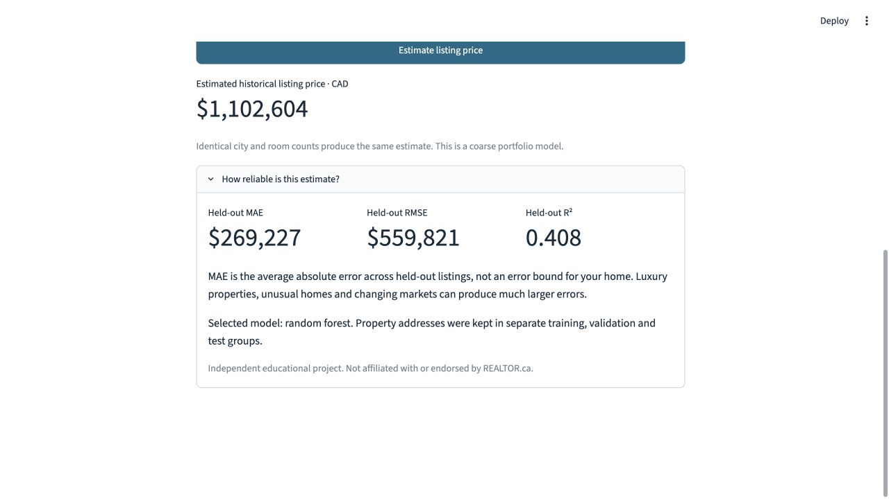
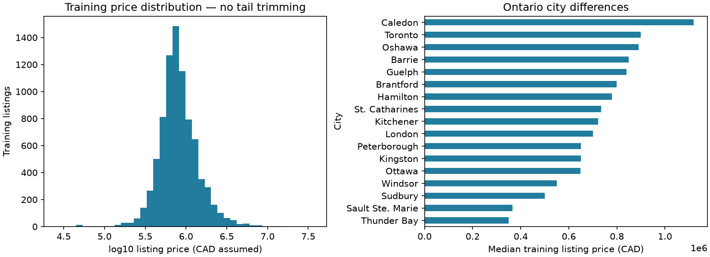
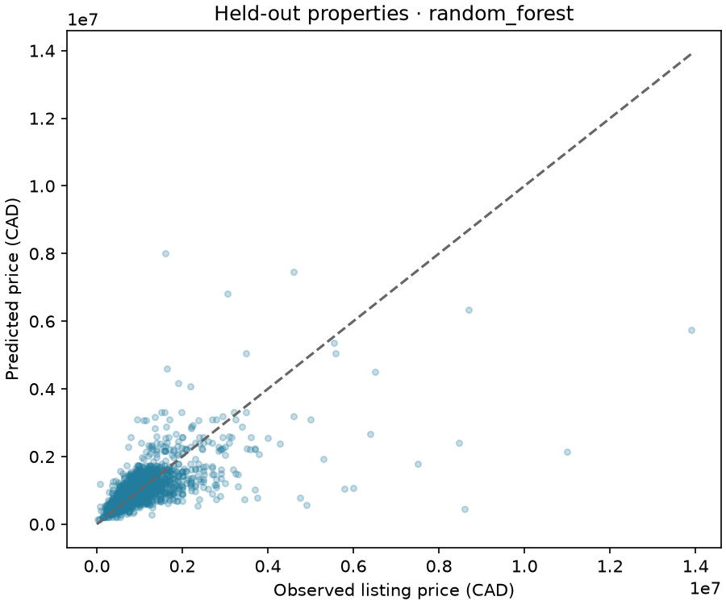

# Ontario Home Estimate

**A reproducible regression project and interactive home listing-price estimator.**
Enter an Ontario city, bedrooms and bathrooms—or try importing a Realtor.ca listing—to
get a model estimate with visible evaluation results and limitations.

Built with Python, pandas, scikit-learn and Streamlit. The original notebook's
linear-model and random-forest experiments are preserved in
[`notebooks/archive`](notebooks/archive). The maintained implementation separates
ingestion, training, inference and the demo into tested modules.

> **Historical listing-price estimate, not a current appraisal.** The source filename
> indicates a 2023 snapshot. These are interpreted as asking prices in CAD, not
> verified sale prices. Held-out MAE is approximately **$269,227**. The model is useful
> for demonstrating ML methodology; it is too coarse to value an individual property
> reliably or guide a purchase decision.



## Try it locally

Use **Python 3.12** and run these commands from the repository root. A virtual
environment keeps the project dependencies isolated. The lock file reproduces the
versions used for the reported experiment; editable installation exposes the local
package to both training and Streamlit.

```bash
python3.12 -m venv .venv
source .venv/bin/activate
python -m pip install -r requirements-lock.txt
python -m pip install --no-deps -e .
house-price-train
streamlit run app.py
```

On Windows, activate with `.venv\Scripts\activate` instead. Open the local URL printed
by Streamlit. Training creates `artifacts/model.joblib` and regenerates the reports;
the model binary is intentionally excluded from Git. Only load model artifacts you
created or trust: joblib/pickle files can execute code. To choose another trusted
local artifact, set `HOUSE_PRICE_MODEL` before starting the demo.

For development with compatible rather than locked dependency versions:
`python -m pip install -e '.[dev]'`. Numerical results may vary across versions and
platforms. No hosted deployment is claimed.

### Estimate a home

1. **Manual entry:** choose one of the 17 supported Ontario cities, then enter bedrooms
   and bathrooms. Toronto is the initial example, not an inferred location.
2. **Listing link:** paste an HTTPS `realtor.ca/real-estate/...` property URL and click
   **Read listing details**. The importer reads unambiguous public residence JSON-LD
   when available; it never uses the asking price as a model input.
3. **Fallback:** if the site blocks access or lacks supported metadata, paste text such
   as `Toronto, Ontario · 3 + 1 Bedrooms · 2 Bathrooms`, then click **Use pasted details**.
4. Review every field and click **Estimate listing price**. Missing imported fields
   retain the previous values, explicitly called out in the interface. Additional
   bedrooms in `3 + 1` are counted as four; confirm that interpretation for your listing.

**Realtor.ca import is best effort, not a guaranteed integration.** The live page check
returned HTTP 403. Successful extraction is covered with controlled HTML fixtures,
not claimed as verified against a live listing. The reader uses fixed allowed hosts,
HTTPS, timeouts, a response-size limit and no redirects. It does not bypass access
controls, use private APIs or store listing pages. Manual entry and pasted text work
without network access. This project is not affiliated with REALTOR.ca.

## Problem and data

The task is supervised regression: estimate a home's listing price from the limited
features in the existing repository's Canadian housing CSV. The active scope is
**17 Ontario cities**, including Toronto; it is not all Ontario municipalities.

The original `HouseListings-Top45Cities-10292023-kaggle.csv` is preserved byte-for-byte
at [`data/raw/ontario_listings_source.csv`](data/raw/ontario_listings_source.csv).
It contains 35,768 records. Its name suggests Kaggle and October 29, 2023, but the
original repository contains no dataset URL, license, collector or methodology.
Those details remain unverified; see [`data/README.md`](data/README.md). No new
housing data or synthetic training records were added.

| Input | Treatment |
|---|---|
| City | One-hot encoding; unknown categories supported internally, unsupported demo cities rejected |
| Number of beds / baths | Training-median imputation, `log1p`, standardization |
| Population | Training-median imputation, `log1p`, standardization |
| Latitude / longitude / median family income | Training-median imputation and standardization |
| Address | Used only to keep repeated properties in the same split; excluded from predictors |
| Price | Regression target; never an input |

Population, coordinates and income are constant within each city in this dataset.
The demo fills these using city medians from **training data only**, matching the
available feature resolution. The model does not know street-level location,
floor area, lot size, property type, condition, age or sale date. Two homes with the
same city and room counts receive the same estimate.

### Cleaning audit

The parser checks the CSV schema and record widths before creating a DataFrame,
avoiding silent column shifts from malformed CSV rows.

| Stage | Records removed |
|---|---:|
| Malformed widths at original CSV lines 2 and 3 | 2 |
| Outside fixed Ontario city/province scope | 21,765 |
| Invalid target, unusable address or room counts outside 0–20 | 10 |
| Exact duplicates | 163 |
| **Retained** | **13,828** |

There are 13,738 normalized city/address property groups. Ontario rows labeled as
Regina, Saskatoon, Nanaimo or Winnipeg are excluded rather than silently corrected.
Missing numeric features are handled inside the fitted pipeline. No quantile price
trimming is used, so expensive homes remain in evaluation. The source-data SHA-256
and all counts are recorded in [`reports/metrics.json`](reports/metrics.json).

## Methodology

1. Apply deterministic schema, geographic and validity rules, remove exact duplicate
   records, and normalize city/address keys while retaining unit identifiers.
2. Split **property groups** approximately 60%/20%/20% with seed 42:
   **8,300 training**, **2,764 validation**, **2,764 test** rows. Repeated normalized
   addresses cannot cross splits. Address spelling variants can still evade grouping.
3. Fit each candidate's imputer, scaler and encoder on training data only. Log
   transforms preserve the original notebook's treatment of beds, baths and population.
4. Compare four fixed candidates using **validation MAE**. There is no test-set tuning
   or exhaustive search. Ridge is the regularized linear baseline; the random forest
   continues the original modeling approach; gradient boosting adds a sensible
   nonlinear comparison; the median predictor provides a no-feature reference.
5. Evaluate the selected candidate once on the held-out test split, with a median
   baseline reference, MAE, RMSE, R² and city-level diagnostics. Rerunning the fixed
   experiment is a reproducibility check, not a new independent test.
6. Serialize the complete selected pipeline and training-derived city context using
   joblib. It remains fitted on training only, matching the evaluated model; there
   is no unreported refit on validation or test data.

Candidate settings are explicit in [`src/house_price/model.py`](src/house_price/model.py):
Ridge alpha 10; random forest with 250 trees, depth 16 and minimum leaf size 5;
histogram gradient boosting with 200 iterations, 15 leaves, L2 10 and no internal
early-stopping split. These are modest fixed configurations, not claimed as optimal.

## Observed results

Recorded with Python 3.12.3, scikit-learn 1.9.1, pandas 3.0.6 and NumPy 2.5.3.
MAE/RMSE are in assumed CAD; R² is dimensionless, **not classification accuracy**.

| Candidate | Validation MAE | Validation RMSE | Validation R² |
|---|---:|---:|---:|
| Median baseline | $396,320 | $717,767 | -0.064 |
| Ridge | $335,125 | $567,898 | 0.334 |
| **Random forest — selected** | **$276,463** | **$525,449** | **0.430** |
| Histogram gradient boosting | $281,473 | $540,216 | 0.397 |

| Held-out test | MAE | RMSE | R² |
|---|---:|---:|---:|
| Selected random forest | **$269,227** | **$559,821** | **0.408** |
| Median baseline | $372,238 | $745,284 | -0.049 |

The selected model reduces test MAE by **27.7%** relative to the median baseline.
Toronto alone has 236 test rows: MAE **$317,584**, RMSE **$636,680**, R² **0.584**.
Performance varies substantially across cities; Peterborough's negative R² is a
notable failure case, documented alongside all other cities in the metrics report.
The original notebook's saved scores are not comparable: it trimmed price tails,
used unseeded splits and repeatedly inspected test scores.

### EDA and error analysis



The training distribution is strongly right-skewed, and price levels differ by city.
The retained training range runs from $26,000 to $37 million. This exposes outliers
and uncertain listing quality instead of hiding them through target-based trimming.



Large residuals on high-price listings explain why RMSE is much larger than MAE.
The plotted diagonal is perfect agreement, not a fitted trend. These are final test
diagnostics; no model changes were chosen to improve this scatter after inspection.

## Architecture

```text
Raw CSV → validated Ontario records → address-grouped train / validation / test
                                     ↓
                  train-only preprocessing + four regressors
                                     ↓
                       select by validation MAE
                                     ↓
                  test metrics + persisted pipeline
                                     ↓
Realtor.ca metadata / pasted text / manual fields → validation → Streamlit estimate
```

```text
app.py                         Streamlit interface
src/house_price/
  data.py                      CSV audit, fixed scope, grouped splitting
  model.py                     Preprocessing and candidate pipelines
  train.py                     Evaluation, persistence and diagnostic plots
  predict.py                   Input validation and inference
  listings.py                  Best-effort public listing/text import
notebooks/archive/             Untouched original notebook and migration notes
data/raw/                      Original source CSV
artifacts/                     Locally generated model; ignored by Git
reports/                       Measured results and figures
tests/                        Ingestion, leakage, inference, importer and UI tests
requirements-lock.txt          Exact tested environment dependencies
pyproject.toml                 Package metadata and compatible dependency ranges
.github/workflows/tests.yml    Automated checks and training smoke run
```

## Verification

Run from the repository root with the environment active:

```bash
python -m pytest -q
ruff check src app.py tests
ruff format --check src app.py tests
python -m pip check
house-price-train
```

Tests cover source auditing, schema rejection, grouped-split separation and
repeatability, inference without refitting, missing/unseen features, serialization
round trips, invalid user inputs, importer URL restrictions, HTTP failures,
timeouts, oversized responses, asking-price exclusion and Streamlit interaction.
UI tests use a lightweight test artifact whose metrics are fixtures, never portfolio
results. Reported results come from the full training command on the real source CSV.
GitHub Actions is configured to run checks and a training smoke test; its status
must be checked on the pull request rather than assumed from local results.

## Limitations and next steps

- The apparent 2023 snapshot is stale, provenance is incomplete, and labels are not
  verified sale prices. Obtain licensed, dated transactions before claiming current
  market value or using the tool for financial decisions.
- City and room counts are weak property descriptors. Add verified floor area,
  property type, condition and neighborhood features before chasing larger models.
- Random grouped splits measure same-snapshot generalization, not future-market or
  unseen-city performance. Temporal evaluation needs timestamps not present here.
- Address normalization is approximate. There may be undetected duplicates, mixed
  listing types or data errors. No price interval or calibrated confidence claim is made.
- Subgroup sample sizes are uneven; small-city metrics are unstable. The high RMSE
  and negative R² in one city are reasons for caution, not deployment readiness.
- Live Realtor.ca extraction was blocked in testing. An authorized data feed would
  be preferable for reliable import; pasted text and manual fields are supported now.

## Resume wording grounded in this implementation

- Built a reproducible scikit-learn pipeline for 13,828 Ontario housing listings,
  comparing four regression candidates with property-grouped train/validation/test
  splits and reducing held-out MAE 27.7% versus a median baseline.
- Developed a Streamlit price-estimation demo with validated housing inputs,
  best-effort Realtor.ca metadata import, pasted-text fallback, serialized preprocessing
  and automated tests for data integrity, inference and UI behavior.
